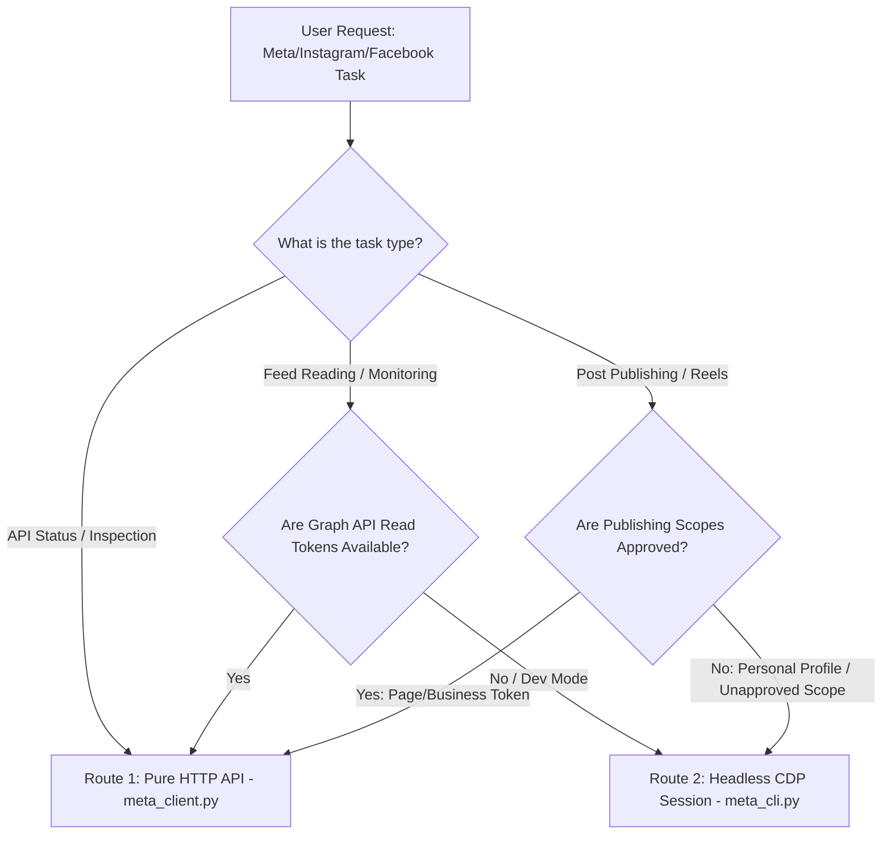

# 🤖 Meta API & Automation - Agent Routing & Workflow Specification (AGENTS.md)

This document is the **primary agent operating manual** for executing Meta (Instagram, Facebook, Threads) automation tasks. It defines routes, decision matrices, execution protocols, error handling, and universal multi-user workflows.

---

## 🧭 1. Agent Decision & Routing Matrix

When an agent receives a Meta-related request, determine the optimal execution path according to the following decision tree:



| Task Category | Recommended Tool | Command / Action | Why? |
| :--- | :--- | :--- | :--- |
| **Check Token / App Details** | `meta_client.py` | `--action status` | Zero-browser, 100ms response, official validation |
| **Publish Page/IG Post (Official)** | `meta_client.py` | `--action post-fb` / `post-ig` | Permanent server token, zero UI drift risk |
| **Publish Personal Feed / Reels** | `meta_cli.py` | `post-ig` / `post-fb` | Bypasses App Review & permissions gate |
| **Read Home Feed / Reactions** | `meta_cli.py` | `read-ig` / `read-fb` | Reads actual user timeline without Graph API restrictions |
| **Extract New App Credentials** | `meta_token_helper.py` | `--extract-all` | Automates developer center token generation |

---

## 🔑 2. Multi-User Environment Configuration

The skill is built to be **100% universal and user-agnostic**. Agents should load credentials using standard precedence:

1. **Environment Variables**: `META_APP_ID`, `META_APP_SECRET`, `META_APP_ACCESS_TOKEN`, `META_USER_ACCESS_TOKEN`, `META_PAGE_ACCESS_TOKEN`.
2. **Workspace `.env`**: Local directory `.env` file.
3. **Global `~/.env`**: User's home directory configuration.
4. **Direct Arguments**: CLI parameters passed directly by the caller.

### Sample Configuration (`.env.example`):
```env
# Meta Official Graph API
META_APP_ID=your_app_id
META_APP_SECRET=your_app_secret
META_APP_ACCESS_TOKEN=your_app_id|your_app_secret
META_GRAPH_API_VERSION=v20.0
META_GRAPH_API_URL=https://graph.facebook.com/v20.0/

# User & Target Entity IDs
META_IG_USER_ID=your_instagram_user_id
META_FB_USER_ID=your_facebook_user_id
META_FB_PAGE_ID=your_facebook_page_id

# Headless Automation Port & Directory (Optional)
META_CDP_PORT=9222
META_CHROME_PROFILE_DIR=~/.meta_chrome_profile
```

---

## 🛠️ 3. Execution Routes & CLI Commands

### Route A: Pure HTTP Graph API (`scripts/meta_client.py`)
Use when you need fast, stateless API execution without starting Chrome:

```bash
# 1. Inspect Token and Application
python3 scripts/meta_client.py --action status

# 2. Get User / Page Profile
python3 scripts/meta_client.py --action get-profile --fields id,name,picture

# 3. Publish Facebook Feed Post (Requires Page Access Token)
python3 scripts/meta_client.py --action post-fb --page-id "PAGE_ID" --message "New AI Launch!"

# 4. Publish Instagram Container Post
python3 scripts/meta_client.py --action post-ig --ig-user-id "IG_ID" --image-url "https://ai-ing.org/logo.png" --caption "AI Automation #AI"
```

### Route B: Headless Session Runner (`scripts/meta_cli.py`)
Use when the user wants to operate directly on their logged-in personal accounts:

```bash
# 1. Post image to Instagram Feed
python3 scripts/meta_cli.py post-ig --image "/path/to/image.png" --caption "Weekly Update! #AI"

# 2. Post text to Facebook Profile
python3 scripts/meta_cli.py post-fb --text "Hello from autonomous AI agent!"

# 3. Scrape latest Instagram home feed
python3 scripts/meta_cli.py read-ig --limit 10

# 4. Scrape Facebook feed updates
python3 scripts/meta_cli.py read-fb --limit 10
```

---

## ⚠️ 4. Error Handling & Recovery Protocols

1. **`OAuthException` / `Error 190 (Invalid Token)`**:
   - Cause: User Access Token expired or permissions revoked.
   - Fix: Fall back to `META_APP_ACCESS_TOKEN` (`{app_id}|{app_secret}`) for app queries, or launch `meta_token_helper.py` to refresh the user token.

2. **`Error 200 (Permission Denied / Missing Scopes)`**:
   - Cause: The App is in Development mode and lacks reviewed permissions (e.g. `pages_manage_posts`, `instagram_content_publish`).
   - Fix: Seamlessly switch to **Route B (Headless Session Mode via `meta_cli.py`)**.

3. **`CDP Connection Refused (port 9222)`**:
   - Cause: Chrome remote debugging session is not running.
   - Fix: Execute `python3 scripts/meta_session_helper.py --launch` to spawn the persistent Chrome instance.
